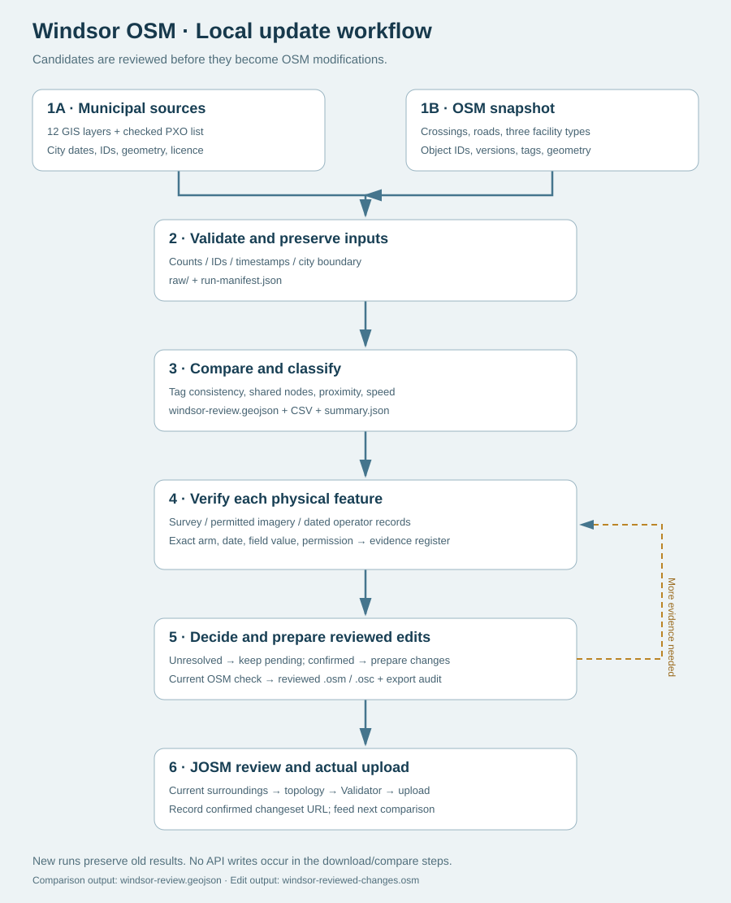

# Windsor OSM / Municipal Open-Data Review

An AI-assisted comparison of OpenStreetMap and public municipal data across the **entire City of Windsor, Ontario**, prepared with Codex. It includes reproducible source snapshots, review findings, bilingual workflow documentation, a diagram, and tools for preparing individually reviewed tag edits in JOSM.

**713 screening records are not 713 confirmed errors. No OSM changes have been uploaded by this project. No preapproved correction batch is supplied.**

## Start here

- [Full analysis and limitations](review/README.md)
- [English local workflow](review/LOCAL-WORKFLOW.en.md) · [中文本地流程](review/LOCAL-WORKFLOW.zh-CN.md)
- [Workflow diagram](review/workflow.svg) · [Mermaid source](review/workflow.mmd)
- [Main candidate GeoJSON](review/windsor-review.geojson) · [CSV](review/windsor-review.csv) · [Summary](review/summary.json)
- [Data inventory and snapshots](data/README.md) · [Sources](review/source-register.csv)
- [Publication scope](PUBLICATION-SCOPE.md) · [Data licences](DATA-LICENSES.md)

Download the repository ZIP and extract it. Open review/LOCAL-WORKFLOW.html for the bilingual guide, review/windsor-review-map.html for the offline map, or review/START-HERE.html for the 40-node before/after editor. GitHub's source view does not execute these HTML pages; use the downloaded local files.



## What is included

| Area | Contents |
|---|---|
| Analysis | 713 candidate records; 9 priority locations; 9,141 crossing nodes and 7,255 crossing ways in the snapshot |
| Review tools | 40 conflicting-tag nodes in 5 recorded-attribute groups; individual evidence/approval; live version checks; .osm/.osc export |
| JOSM context | 9 unmodified local .osm snapshots with existing IDs, versions and references |
| Raw inputs | All 12 municipal layers and metadata; full OSM response; 13 local API responses; 255-object version check |
| Workflow | English/Chinese instructions, SVG/Mermaid diagram, source and evidence registers |
| Reproducibility | Portable downloader/comparison runner, snapshot replay, export tests and checksums |
| Archive | Labelled early-area/stale snapshots excluded from final counts |

The full OSM response is losslessly gzipped to keep the repository manageable. Municipal editor identifiers and OWNER fields have been removed; geometry and comparison fields are retained. See data/README.md.

## Run locally

Requires Node.js 22 or newer for scripts; no third-party dependencies. Browser review is standalone. Actual editing/upload uses JOSM.

```text
node tools/validate.mjs
node tools/replay-snapshot.mjs
node review/refresh/refresh.mjs --previous review/windsor-review.geojson
```

On Windows, review/refresh/RUN-UPDATE.cmd runs a new public-data refresh. New runs are stored separately. A live refresh can be rate-limited or fail if upstream fields change; it stops rather than accepting incomplete data. The PXO list is manually maintained in sources-config.json and must be checked against the official page each time.

The original 40-node editor and 9 priority-site notes remain tied to the original snapshot; a refresh does not silently renew their physical evidence or approvals. New comparisons output results/windsor-review.geojson, its CSV, summary.json, delta-summary.json and an evidence register. An individually reviewed edit export is a separate windsor-reviewed-changes.osm file.

## Evidence and limitations

OSM analysis snapshot: **2026-10-28T03:27:02Z**, or 27 October 2026 at 23:27:02 in Toronto. Raw source and main-API retrieval times are recorded. City GIS and City webpages share one publisher; they are not independent field observations. Similar recorded attributes do not establish identical physical crossings or a 99% accuracy rate.

Detailed screening covers crossings, bicycle parking, EV charging, washrooms and road speeds. Sidewalks, bicycle lanes, heritage and projects received inventory/field review, not complete feature-level conflation. Geometric and matching limitations are documented in the report.

Snapshot replay reproduces all 713 candidate keys and geometries. Export logic has 22 passing checks. A complete new online refresh, rendered-browser export and live JOSM upload have not been validated end to end. Resolve source permission, current physical conditions and any applicable community import/automated-edit process before uploading.

## Contributing

Please include the candidate stable key or OSM object ID, exact road arm, observation date, evidence URL/photo ID, and what field the evidence supports. Unknown is not no. A candidate disappearing in a later run is not automatically proof of a fix. Record a changeset URL only after confirmed upload.

Original code/prose: MIT. OSM-derived data: ODbL. City data: City of Windsor Open Government Licence. See DATA-LICENSES.md; GitHub publication does not settle OSM import compatibility.
